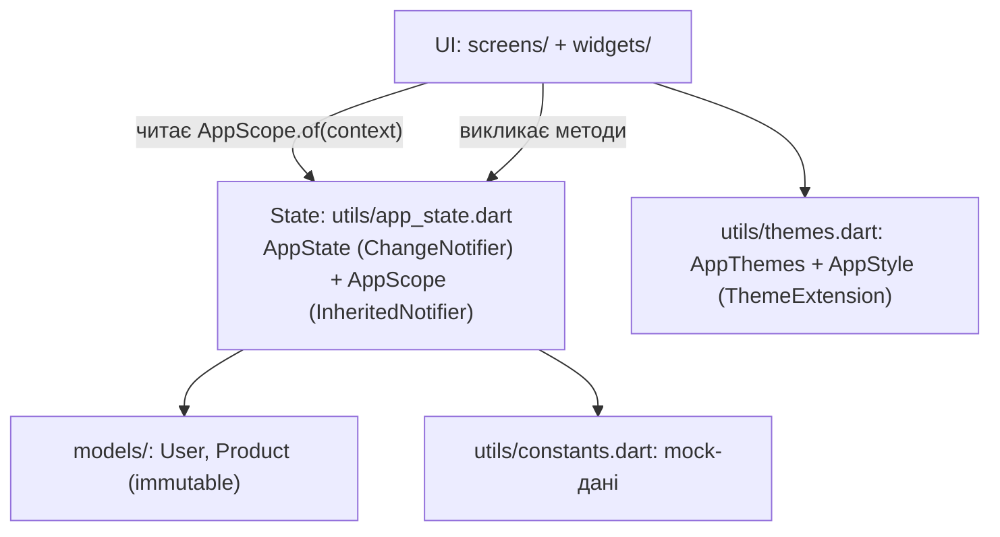
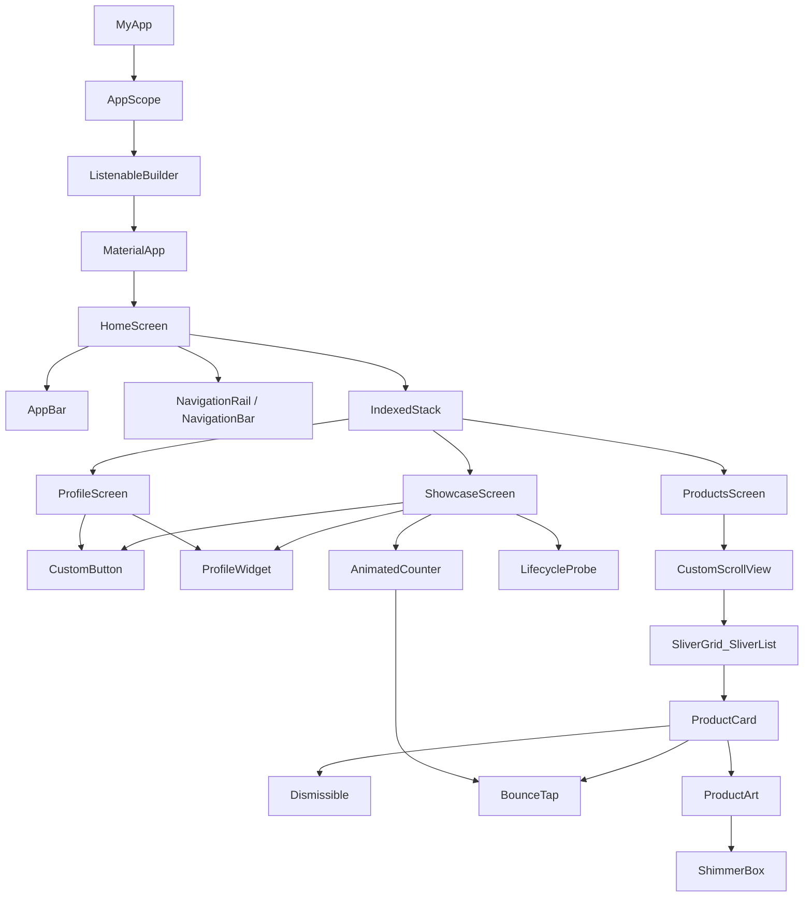
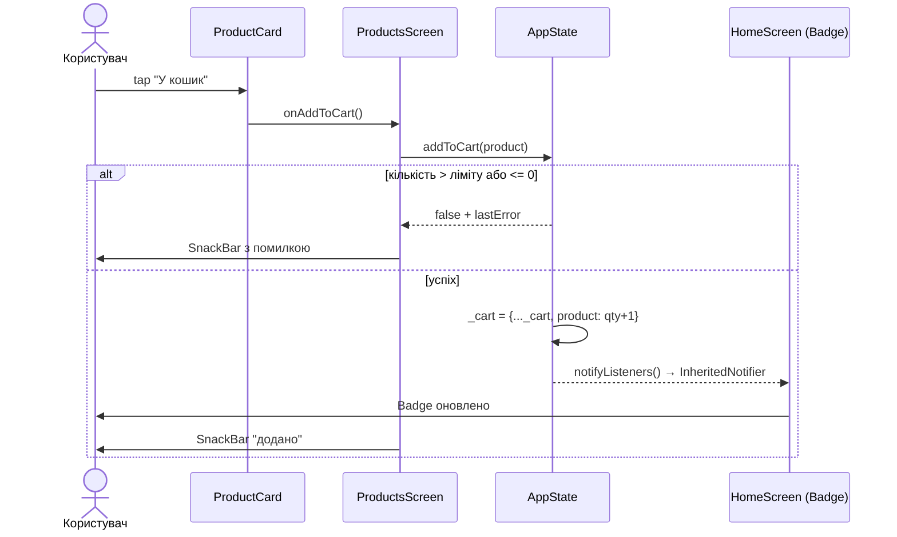
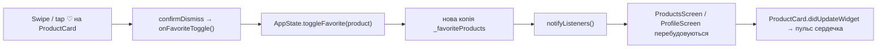

# Архітектура застосунку

> Діаграми написано в Mermaid. Для draw.io: **Arrange → Insert → Advanced → Mermaid**
> (вставте код блоку). Для Miro: додаток *Mermaid* / *Diagramming*. Також Mermaid
> рендериться безпосередньо на GitHub.

## 1. Шари



Принципи: єдине джерело правди (`AppState`), імутабельні оновлення колекцій, віджети не зберігають
бізнес-стан, а лише локальний UI-стан (анімації, натискання). Валідація — в моделі/стані, помилки — через `lastError`.

## 2. Дерево віджетів



## 3. Потік стану: додати товар у кошик



## 4. Потік стану: обране (swipe)



## 5. API contract (mock)

Дані зараз беруться з `kMockProducts`. Контракт, під який легко замінити джерело на REST:

| Метод | Шлях | Опис | Відповідь |
|---|---|---|---|
| GET | `/api/products?category=` | список товарів | `200 [Product]` |
| GET | `/api/products/{id}` | один товар | `200 Product` / `404` |
| GET | `/api/me` | поточний користувач | `200 User` |
| PUT | `/api/me` | оновити профіль (`name`, `email`) | `200 User` / `422 {error}` |
| POST | `/api/cart/items` | `{productId, quantity}` | `200 Cart` / `422 {error}` |
| DELETE | `/api/cart/items/{productId}` | прибрати з кошика | `204` |
| PUT/DELETE | `/api/favorites/{productId}` | додати/прибрати з обраного | `204` |

```json
// Product
{ "id": "p1", "title": "Бездротові навушники", "description": "…",
  "price": 1899.0, "category": "Електроніка", "emoji": "🎧",
  "colorValue": 4282431989, "imageUrl": null }
// User
{ "id": "u1", "name": "Олександр Шевченко", "email": "oleksandr@example.com", "avatarUrl": null }
```
